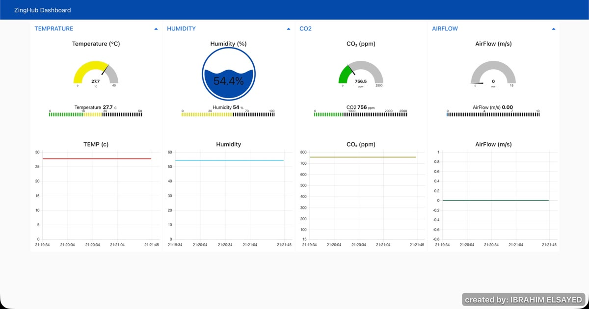
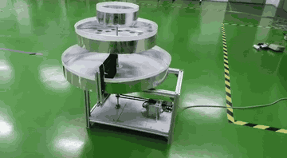

  

<h2 align="center">Welcome to my robotics workshop 🤖</h2>
<h3 align="center">Robotics &amp; Embedded Systems Engineer • ROS 2 • Embedded C • Sensor PCBs</h3>

<b>I build robots and the software that keeps them working outside the lab.</b>

  

---

### 📡 Connect with me

  
  
  
  

📍 Based in **Dubai, UAE** · open to robotics, embedded systems and automation roles · [📄 Download my CV](https://ibrahimelsayed804.github.io/Ibrahim_Elsayed_CV.pdf)

### 👨‍💻 About me

- 🔭 **Most recently:** Software Engineer, Systems Integration at **Heralds Investments**, Dubai (Nov 2025 – Sep 2026): hardware-software integration layers and real-time DDS/MQTT telemetry for autonomous platforms
- 🛠️ **Before:** Robotics intern at **Robopreneur**, validating service robots in live customer deployments · Cybersecurity intern at **SHRDC Smart Factory**, securing 12 Raspberry Pi devices on an industrial network
- 🎓 **B.Eng Mechatronics (Hons)**, University of Wollongong Malaysia, recognised under the **Washington Accord**
- 🏛️ Student Member, **The Institution of Engineers, Malaysia (IEM)**
- 💬 Ask me about **ROS 2, embedded C, I²C sensor buses and custom PCBs**
- 🧗 Outside the lab: certified in bouldering and top-rope climbing

### 🧰 Tech stack

  

  
  
  
  
  
  
  
  
  
  
  
  

### 🚀 Projects

**⭐ Final Year Project — Cloud-Based IoT Indoor Air Quality Monitor** (UOW Malaysia, 2025)
- Multi-point sensor network (SCD41 CO₂/temp/RH + FS3000 airflow) on a Raspberry Pi 5
- 3 custom PCBs: dual TCA9548A I²C multiplexers and P82B715 bus extenders for long sensor runs
- Python → MariaDB logging, live Node-RED dashboard, custom electrical enclosure
- 3-day study benchmarked against WHO, ASHRAE 55, OSHA and ICOP IAQ 2010 · code: [Indoor-Air-Quality-Monitor](https://github.com/ibrahimelsayed804/Indoor-Air-Quality-Monitor)

**1. Autonomous Navigation Stack (ROS 2)**
- Modular C++ navigation libraries with EKF fusion of IMU and LiDAR
- Stable localisation in GPS-denied environments
- Custom ROS 2 nodes for deterministic message delivery

**2. Humanoid Robot — ROBOTIS Bioloid (CM-530)**
- Assembled, wired and programmed a Bioloid humanoid on the CM-530 controller (ARM Cortex-M3) · code: [bioloid-humanoid-cm530](https://github.com/ibrahimelsayed804/bioloid-humanoid-cm530)

**3. Trash Collection & Classification Machine** (prototype)
- Motor-driven, multi-tier rotating sieve that separates mixed waste by size
- A fixed guide wall sweeps sorted items off the tray into a collection bin

**Repositories:** [bioloid-humanoid-cm530](https://github.com/ibrahimelsayed804/bioloid-humanoid-cm530) · [Indoor-Air-Quality-Monitor](https://github.com/ibrahimelsayed804/Indoor-Air-Quality-Monitor)

### 📊 GitHub stats

  
  

  

  

